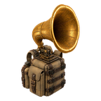

# WePlay: Lullaby -- Crowd Control Equipment (`WePlayLullaby`)

A gramophone backpack that sings nearby enemies to sleep. Biters and spitters close by fall asleep, spitters further out are lured in, and worms are hushed. Sleepers wake in fits and starts and creep closer, so you get total freedom to stand around... for a few seconds.

- **Factorio:** 2.1
- **Dependencies:** base ≥ 2.1.0 (Space Age not required)
- **Current version:** 0.3.1

## In game

Lullaby plays while biters are within 9 tiles or spitters within 20, pulsing once a second, and winds down two pulses after the last one leaves. Worms alone don't wake it up, but they're hushed while it plays.

| Layer | Radius | Who | What happens |
|---|---|---|---|
| Sleep | 9 tiles | Biters and spitters | Held in place, twitching. Each pulse they may scuttle 2 tiles closer; the chance builds every pulse they stay put (faster for bigger enemies). |
| Siren song | 20 tiles | Spitters | Entranced too, and drawn in toward you until they're in the sleep layer. They can't fire while entranced. |
| Worm hush | 50 tiles | Worms | Stop firing while you're in range and the song lasts. |

A biter that falls asleep 9 tiles out takes about 12–22 seconds to reach you; behemoths about 9–14. Spitters creep all the way in too, to point blank (2 tiles, 3 in a vehicle). Entranced enemies won't glide through walls, buildings, trees, rocks or water.

**Full wake:** an enemy wakes fully when it creeps to point blank, when you move away and leave it behind, or when the song stops. It then ignores Lullaby for the immunity time (30 s by default).

**Missed pulse:** each pulse costs power (15 kJ plus 4 kJ for every enemy held, lured or hushed). If the module doesn't have enough for a pulse, the record scratches and everyone wakes at once.

**One per grid:** a second Lullaby placed in the same grid is handed back. If you're in a vehicle with one and wear one too, only one plays: the higher quality one, or the vehicle's if they match.

### Look and sound

- A gold twisted sunburst turns slowly around you like projected light, drawn over ore, rocks and trees and warped as if cast over bumpy ground, with ragged edges and drifting, smoky patches of light. It's brightest at the bottom of the screen and dimmer toward the top, for a sense of depth. Its twist swings one way, then back, and each pulse sends a jagged wave from the centre to the edge, with a soft swell of light and a gold glow. The rays glow onto what's underneath them: a soft bloom by day, and at night they actually light up the ground, buildings and biters beneath them.
- Entranced enemies get a light blue swirl over their heads that spins faster as they get ready to scuttle.
- A brass pad played like an old record: swells in, a sub-bass thrum on each pulse, runs down like a turntable losing power, and scratches on a missed pulse.

## Map settings

| Setting | Default | Range | What it does |
|---|---|---|---|
| Immunity after waking (seconds) | 30 | 0 – 60 | How long a fully woken enemy ignores the lullaby. 0 turns it off. |
| Worms can be re-entranced | Off | On / Off | Off: each worm is hushed once. On: worms can be hushed again after their immunity. |
| Pulse brightening (%) | 50 | 0 – 100 | How much the rays and glow brighten on each pulse (a soft swell once a second). 0 turns it off for a steady glow. |

**Light sensitivity:** while Lullaby is playing, its light brightens softly once a second. If you're sensitive to pulsing light, set Pulse brightening to 0 for a steady glow.

## Getting it

Research **Lullaby** after Modular armor, Circuit network, Advanced circuit and Military 2 (200 × automation, logistic and military science, 30 s each).

| Recipe | |
|---|---|
| Ingredients | 1 × Programmable speaker, 10 × Advanced circuit, 5 × Steel plate |
| Crafting time | 10 s |
| Equipment size | 2 × 2 |
| Power | 1 MJ buffer, charges at up to 400 kW |

## How it works

- **Equipment:** a `battery-equipment` that only charges (`output_flow_limit = 0W`). The script spends its energy on each pulse.
- **Wearers:** each connected player's armor grid and current vehicle grid are checked; the best Lullaby is used and centred on the vehicle if driving, otherwise the character. Idle wearers are scanned every 30 ticks.
- **Holding:** entranced units are kept as real units, disabled with `disabled_by_script` (falls back to `active`). They keep their health, resistances, unit number and corpse, and turrets can still shoot them. They never walk on their own while entranced: twitches, scuttles and spitters being drawn in are all small scripted teleports (every 2 ticks), and a step is skipped if the spot is blocked (water tile, or anything on the `player` collision layer that isn't a unit or vehicle).
- **Spitters:** units with a stream attack or range over 4 are entranced anywhere in the lure layer and glide in at 0.05 tiles per tick until they're in the sleep layer.
- **Worms:** enemy `turret` entities in range are disabled by script while hushed.
- **Bookkeeping:** `storage.claimed` stops two wearers grabbing the same enemy; `storage.immune` holds immunity end ticks; `storage.worms_done` remembers hushed worms when re-entrancing is off (cleared when a worm is destroyed).
- **Visuals:** `rendering.draw_animation` for the rays (40 frames, one loop per 2 pulses, offset so frame 0 lands on a beat; rotation and the bumpy warp are baked in; additive blend; first render layer that works from `higher-object-under`, `object`, `decals`) and swirls (16 frames), `rendering.draw_light` for the glow. A blurred, half-resolution copy of the rays (`wp-lullaby-rays-bloom`, same 40 frames and timing, additive) gives the daylight bloom; a 20-frame ray-shaped light (`wp-lullaby-ray-light-0..19`, swapped by script every 6 ticks) lights up what's under the rays at night.
- **Sound:** pulse chunks are 70 ticks (60 + 5-tick fades) and start 5 ticks before each beat, so they crossfade. The start sound is 35 ticks and hands over to the first pulse; the stop sound takes the next pulse's slot.

Balance and tuning numbers live in `balance.lua`.

### Not in this first pass

- Bubble Gun-style sprite swap and struggle animation (sleepers twitch in place instead).
- Spidertrons driven by remote, and grids filled by robots (only player-placed duplicates are handed back).
- Research or quality bonuses.
- Pentapods and demolishers aren't affected.

## Tools (not in the zip)

- `tools/lullaby_sounds.py`: builds the sounds from the Envato clip.
- `tools/lullaby_rays.py`: builds the ray sprite sheet.
- `tools/lullaby_swirl.py`: builds the swirl sprite sheet.

## Credits

- The equipment icon, technology icon and thumbnail were made with AI image generation (Grok).
- The ground rays and swirls were drawn procedurally for this mod.
- Sounds were built from an Envato Elements asset ("Brass Swell 5"), reworked into a swell-in, crossfading pulse loops with a sub-bass thrum, a turntable run-down and a record scratch. The sound files are used under the Envato Elements licence and are not covered by the Unlicense.

## Licence

Code released under the Unlicense (the sound files stay under their Envato Elements licence).
